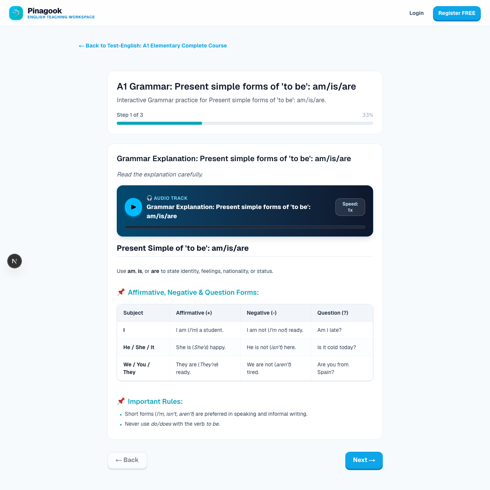
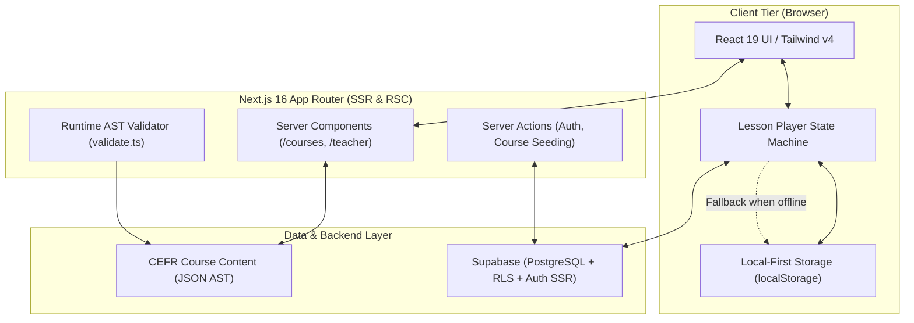

# 🐬 Pinagook — Interactive Language Learning Platform

<p align="center">
  
</p>

<p align="center">
  <strong>A modern, full-stack EdTech web application for interactive English language learning, automated placement testing, and structured curriculum delivery.</strong>
</p>

<p align="center">
  
  
  
  
  
  
  
</p>

---

## 📖 Executive Summary

**Pinagook** is a production-grade language learning application designed for freelance educators and self-directed students. Inspired by real online tutoring workflows, it bridges the gap between passive textbook study and overly gamified apps by offering structured, CEFR-aligned interactive grammar and vocabulary lessons with instant tactical feedback.

The platform is engineered with a **local-first resilient architecture**, combining **Next.js 16 App Router**, **React 19**, **Supabase SSR authentication**, and a custom **AST-like JSON curriculum engine** covering 10 full courses, 202 lessons, and over 600 interactive exercises.

---

## ✨ Key Features

### 🎓 1. Interactive Lesson Player
- **Deterministic Step-by-Step Flow**: Students progress through structured pedagogical sequences (`explanation` → `practice` → `fill-in-the-blank` → `quizzes`).
- **Tactile Feedback & Gating**: Interactive exercises require students to check their answer before proceeding, preventing skipping and reinforcing retention.
- **Rich Formatted Explanations**: Custom markdown-style parser rendering structured grammar tables, emphasized vocabulary, and contextual rules.
- **Unified Scoring & Review Engine**: Comprehensive end-of-lesson diagnostic displaying percentage score, mistake breakdown, and instant retry options.
- **Automatic Progress Persistence**: Lesson progress is continuously synchronized to `localStorage` and the database, allowing seamless resume after refresh.

### 🧭 2. CEFR Placement Test Engine
- Diagnostic evaluation tool testing competencies across **CEFR levels (A1 to C1)**.
- Analyzes accuracy per difficulty tier to calculate the learner's recommended starting course.
- Interactive results dashboard with direct navigation to the recommended level.

### 📚 3. CEFR Curriculum Hub (A1 – C1)
- 10 complete structured courses with 202 lessons:
  - **A1**: Elementary Grammar & Forms of *To Be*, Present Simple, Articles
  - **A2**: Pre-Intermediate Tenses, Modals, and Conditionals
  - **B1 / B1+**: Intermediate Complex Structures, Passive Voice, Relative Clauses
  - **B2**: Upper-Intermediate Advanced Gerunds, Conditionals, Reported Speech
  - **C1**: Advanced Inversion, Subjunctive, Discourse Markers
- Open course browsing for guests with seamless authentication onboarding when saving long-term progress.

### 🛠️ 4. Teacher CMS & Course Importer
- In-browser authoring studio allowing educators to import custom JSON courses.
- Instant runtime syntax & schema validation before persistence.
- Live course structure preview (lessons, step count, question types).

---

## 🏛️ Architecture & System Design



### 1. Hybrid Local-First & Graceful Degradation
To ensure uncompromised uptime and smooth demo presentations:
- **Cloud-First with Resilient Fallback**: The app connects to Supabase for authentication, cloud progress synchronization, and teacher course management.
- **Offline / Zero-Config Mode**: If the database is unreachable or offline, the system automatically falls back to bundled static JSON courses and client-side `localStorage`, allowing students and interview evaluators to experience the full learning journey without setting up external infrastructure.

### 2. Discriminated Union Content Model
Course content is structured as an Abstract Syntax Tree (AST) using TypeScript discriminated unions:
```typescript
export type Step =
  | StepText
  | StepSingleChoice
  | StepFillBlank;

export interface StepBase {
  id: string;
  type: 'text' | 'single-choice' | 'fill-blank';
  title?: string;
  explanation?: string;
}
```
This guarantees exhaustive pattern matching in the UI renderer and eliminates runtime `undefined` property bugs.

### 3. Lightweight Custom Runtime Validator
Instead of bulky external runtime libraries, course imports are validated through a custom recursive validator (`content/validate.ts`):
- Deep schema verification (ensuring unique IDs, valid options, present correct answers, and non-empty arrays).
- Emits path-based error diagnostics (e.g. `lessons[1].steps[3].options: must contain at least 2 choices`) for immediate teacher feedback.

---

## 🧪 Testing & Quality Assurance

Pinagook employs a multi-tiered automated testing strategy to safeguard core business logic and user flows:

| Test Suite | Framework | Scope / Coverage |
| :--- | :--- | :--- |
| **Unit & Component** | `Vitest` + `React Testing Library` | 48 tests covering Lesson Player state transitions, Check/Next button gating, score computation, and storage serialization. |
| **End-to-End (E2E)** | `Playwright` | Complete multi-step learning journey: Course catalog → Lesson player → Answering single-choice & fill-in-the-blank → Submitting → Score assertion → Reload resumption. |
| **Static Analysis** | `TypeScript` (Strict) + `ESLint 9` | 0 type errors, React 19 compiler immutability verification. |

### Running Tests Locally
```bash
# Run unit and integration tests
npm run test

# Run end-to-end tests in headless browser
npx playwright test

# Verify type safety
npm run typecheck

# Run linter
npm run lint
```

---

## 🎯 Interview Deep-Dive: Architecture Defense

Use this section to confidently explain your technical decisions, trade-offs, and engineering mindset during technical interviews:

<details>
<summary><strong>1. Why did you choose Next.js 16 App Router and React 19?</strong></summary>

> **Talking Point:**  
> "I chose Next.js 16 App Router for its hybrid rendering model. Course catalogs, curriculum listings, and static grammar reference guides benefit heavily from Server Components (RSC) for zero-JS footprint and fast First Contentful Paint (FCP). Meanwhile, the interactive Lesson Player and Teacher Studio are isolated as Client Components (`'use client'`). React 19 allowed us to use modern compiler patterns, cleaner actions with `useTransition`, and performant optimistic UI updates without external state boilerplate."
</details>

<details>
<summary><strong>2. How did you manage state in the Lesson Player? Why not Redux or Zustand?</strong></summary>

> **Talking Point:**  
> "The Lesson Player's state is strictly lifecycle-bound to the active lesson. I implemented a deterministic local state machine utilizing `useState` with encapsulated helper handlers. It manages the current step index, user answers dictionary (`Record<string, string>`), validation checked flags, and submission timestamps. Global state stores like Redux or Zustand would introduce unnecessary indirection for page-scoped state. For persistence across browser sessions, state changes are synced to `localStorage` and asynchronously flushed to Supabase upon lesson completion."
</details>

<details>
<summary><strong>3. How does the application handle network failures or database downtime?</strong></summary>

> **Talking Point:**  
> "I designed the data access layer (`coursesService.ts` and `loaders.ts`) around the **Graceful Degradation** principle. All network and database requests are wrapped in defensive handlers. If Supabase is unreachable (such as paused free-tier instances or offline client connections), the application automatically falls back to bundled static courses and local storage. Furthermore, guests can browse courses and complete lessons immediately without forced sign-up walls, dramatically improving user conversion."
</details>

<details>
<summary><strong>4. Why did you write a custom validator instead of using Zod?</strong></summary>

> **Talking Point:**  
> "While Zod is an excellent tool, writing a zero-dependency recursive validator (`validate.ts`) gave us two distinct advantages: zero added bundle overhead and complete control over error messages. When a teacher uploads a course with a formatting mistake, the validator returns precise, human-readable breadcrumbs like `lessons[0].steps[2].correctAnswer is missing`, enabling teachers to self-correct without technical assistance."
</details>

<details>
<summary><strong>5. What React 19 concurrency or hydration challenges did you overcome?</strong></summary>

> **Talking Point:**  
> "During the React 19 migration, we strictly eliminated render-phase variable mutations (enforced by the React 19 Compiler) in our content parser, refactoring formatting routines into pure functional transforms. We also eliminated hydration mismatches by ensuring client-specific state (like `localStorage` hydration) occurs after initial mount or via lazy state initialization."
</details>

<details>
<summary><strong>6. How is the test suite structured to prevent regressions?</strong></summary>

> **Talking Point:**  
> "We use a testing pyramid focused on high-value confidence. Vitest and RTL verify core user experience invariants (e.g. you cannot click 'Next' before checking an interactive exercise). Playwright E2E tests run in real Chromium browsers to protect the full user funnel: selecting a course, solving exercises, verifying celebratory results, and resuming progress upon page refresh."
</details>

---

## 📂 Project Structure

```
pinagook/
├── app/
│   ├── actions/                  # Server Actions (Auth, course seeding)
│   ├── auth/                     # Authentication pages (Login, Register)
│   ├── components/               # Reusable UI primitives (Button, Navbar, FormattedRenderer)
│   ├── contexts/                 # Global Contexts (AuthContext)
│   ├── courses/                  # Course catalog & dynamic lesson routes
│   │   ├── [courseId]/
│   │   │   └── lessons/[lessonId]/LessonPageClient.tsx  # Dynamic Lesson Player
│   │   └── page.tsx              # Public course browsing
│   ├── features/                 # Modular feature domains
│   │   ├── courses/              # Course retrieval & persistence services
│   │   ├── lesson-player/        # Interactive Lesson Player, step renderers, result view
│   │   └── placement-test/       # Diagnostic CEFR level assessment engine
│   ├── teacher/                  # Teacher Studio & JSON Course Importer
│   ├── layout.tsx                # Root layout with responsive navigation
│   └── globals.css               # Tailwind CSS v4 styling & theme tokens
├── content/                      # CEFR Curriculum data & validation
│   ├── bc-*.json                 # British Council curriculum datasets (A1–C2)
│   ├── test-english-*.json       # CEFR Level courses (A1, A2, B1, B1+, B2, C1)
│   ├── types.ts                  # Discriminated union types for Course AST
│   └── validate.ts               # Recursive runtime schema validator
├── e2e/                          # Playwright end-to-end integration tests
│   └── lesson-player.spec.ts     # Complete user journey tests
├── public/                       # Static assets and UI snapshots
└── scripts/                      # Curriculum crawling and parsing toolchain
```

---

## 🚀 Getting Started

### Prerequisites
- **Node.js**: `v20.x` or higher
- **npm**: `v10.x` or higher

### Installation
```bash
# 1. Clone repository
git clone https://github.com/dtk1/Pinagook.git
cd Pinagook

# 2. Install dependencies
npm install

# 3. (Optional) Set up Environment Variables
# Copy example environment configuration
cp .env.example .env.local
# Add your NEXT_PUBLIC_SUPABASE_URL and NEXT_PUBLIC_SUPABASE_ANON_KEY
# If omitted, the app automatically runs in local-first demo mode!

# 4. Start Development Server
npm run dev
```

Open [http://localhost:3000](http://localhost:3000) with your browser to experience Pinagook.

---

## 📜 License & Acknowledgments

Distributed under the **MIT License**. Created as a modern EdTech portfolio case study demonstrating resilient full-stack architecture, clean code standards, and production-ready testing practices.
